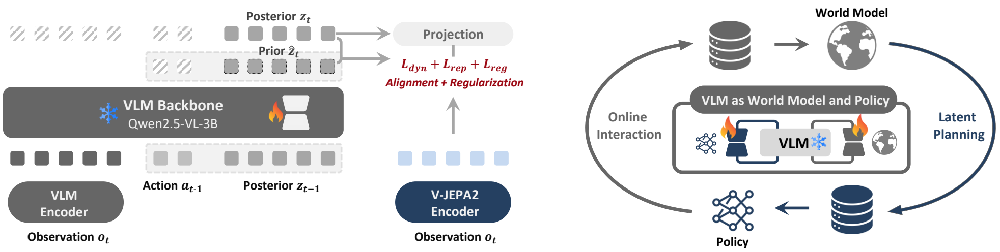
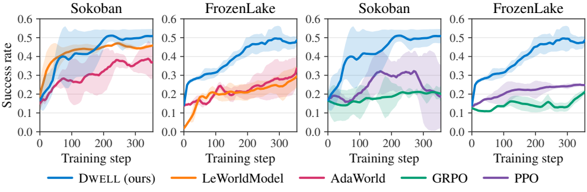
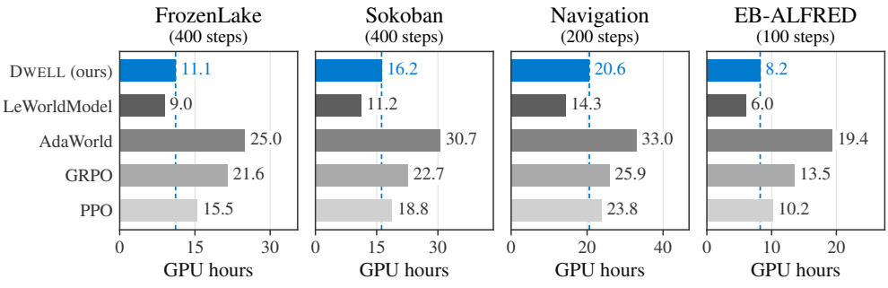

<div align="center">

# Dwell: Vision-Language Agents Can Learn in Their Own Latent Worlds

**Haoxi Li**<sup>1</sup>, **Sikai Bai**<sup>1</sup>, **Jianfei Ma**<sup>2</sup>, **Qinglin Hou**<sup>3</sup>,  
**Xiaocheng Lu**<sup>1</sup>, **Tao Han**<sup>1</sup>, **Jie Zhang**<sup>1,†</sup>, **Song Guo**<sup>1,†</sup>

<sup>1</sup>The Hong Kong University of Science and Technology  
<sup>2</sup>National University of Singapore · <sup>3</sup>University of Southern California  
<sup>†</sup>Corresponding authors

[Code](https://github.com/Tom111-lhx/Dwell) · [Getting Started](#getting-started) · [Data](docs/data.md) · [Training Guide](docs/reproduction.md) · [Citation](#citation)

**Learning to act in a VLM’s own latent world.**

</div>

DWELL equips a pretrained vision-language model with recurrent latent dynamics and improves its policy through imagined experience, without reconstructing future observations. Predicted states are consumed directly by the policy: the representation used to anticipate an action’s outcome becomes the state on which the agent continues to act and learn.

<p align="center">
  
</p>

### Highlights

- **Predict in latent space.** Recurrent posterior updates incorporate observations; action-conditioned priors predict future latent states.
- **Learn from imagined experience.** World modeling and policy learning use separate LoRA adapters on a frozen VLM backbone, with a common latent interface for transitions, rewards, and decisions.
- **Ground predictions in experience.** Real transitions supervise dynamics and task feedback; online world-model refresh supports continued learning in the environments using the alternating protocol.

## Release status

The initial release targets **code and data**. The current repository contains the learning components, grid-environment adapters, and training scripts. Prepared datasets and their download manifests are being organized for release. Checkpoints and training logs are outside the initial release scope.

The manuscript is being prepared for arXiv. The paper link and project website will be added when available.

| Resource | Current availability |
| --- | --- |
| Learning code | Available in [`sembelief_wm/`](sembelief_wm/) |
| Sokoban and FrozenLake | Collection adapters and training entry points included |
| Prepared datasets and evaluation splits | Download links pending; see [data guide](docs/data.md) |
| Navigation, PrimitiveSkill, EB-ALFRED | Evaluated in the paper; release entry points pending |
| Agent demo videos | Forthcoming |

## Getting started

Start with the source checkout and a **Linux / NVIDIA CUDA** environment for model training. The project declares Python 3.10–3.12 and pins PyTorch 2.8.0. Python 3.11 is used in the commands below.

```bash
git clone https://github.com/Tom111-lhx/Dwell.git
cd Dwell
uv sync --frozen --python 3.11
```

This uses the committed dependency lockfile and assumes `uv` is installed. See the [installation guide](docs/installation.md) for model prerequisites and verification status.

### Collect a small RGB dataset

The following example exercises the data pipeline without downloading the VLM. First check that the real Sokoban implementation can be constructed; its adapter also has a mock fallback for development.

```bash
uv run python -c "from sembelief_wm.data.adapters.sokoban import SokobanAdapter; SokobanAdapter(require_real=True).make_env(seed=10000); print('Real Sokoban is available')"

uv run python scripts/train/collect_offline_dataset.py \
  --env-id sokoban \
  --require-real-env \
  --output-dir data/sokoban_example \
  --num-episodes 10 \
  --seed-start 10000 \
  --max-steps 25 \
  --split train \
  --strategy random
```

Expected outputs are `data/sokoban_example/raw/manifest.jsonl` and per-episode `.pt` files. This is a small collection example, **not the paper’s training dataset or a trained-policy demo**. See [data format and split requirements](docs/data.md) before preparing a research run.

These commands have been checked against the source interfaces; a clean Linux/CUDA execution is still pending.

## How DWELL works

1. **Observe.** Encode the current image and update a recurrent posterior state that combines observations with history.
2. **Predict.** Starting from a posterior, recursively apply the action-conditioned prior without future observations.
3. **Evaluate and learn.** Predict task feedback on imagined states and update the actor and critic using PPO.
4. **Refresh.** Collect new real experience and refine the world model in the alternating training protocol.

The world model combines dynamics prediction, visual representation grounding, reward learning, and anti-collapse regularization. A frozen V-JEPA 2 encoder supplies representation targets. The critic is warmed up before imagined policy optimization.

Here, “latent planning” refers to learning from imagined trajectories. The framework does not require decoding future images or searching over image sequences at each real decision. Prior and posterior states are deterministic representations.

See the [training guide](docs/reproduction.md) for code entry points and the existing [implementation notes](pipeline.md) for additional detail. Environment-specific protocols matter: the paper’s EB-ALFRED setting uses a fixed world model and behavior-cloning support.

## Selected results

Success rates below are reported in the manuscript for methods using Qwen2.5-VL-3B. Values are mean ± standard deviation over three training seeds. This compact table shows the two grid environments; it is not an aggregate over all five tasks.

| Method | Sokoban | FrozenLake |
| --- | ---: | ---: |
| PPO | 0.29 ± 0.125 | 0.22 ± 0.036 |
| GRPO | 0.21 ± 0.040 | 0.19 ± 0.052 |
| LeWorldModel (adapted) | 0.44 ± 0.021 | 0.29 ± 0.061 |
| **DWELL** | **0.53 ± 0.012** | **0.51 ± 0.021** |

<p align="center">
  
</p>

The training-step axis counts accepted actor updates for DWELL in these environments. It should not be interpreted as a count of real environment transitions.

### Computation

<p align="center">
  
</p>

Under the reported environment-specific schedules, DWELL uses approximately **38–58% fewer online-training GPU-hours than AdaWorld**. The accounting covers online-training computation, including world-model updates, imagination, and actor–critic optimization. LeWorldModel remains less expensive. These figures are manuscript results, not fresh measurements of this checkout.

## Training and reproduction

The primary entry points are [`scripts/sokoban/run_sokoban_full_training.sh`](scripts/sokoban/run_sokoban_full_training.sh) and [`scripts/frozenlake/run_frozenlake_full_training.sh`](scripts/frozenlake/run_frozenlake_full_training.sh). Both accept `PHASE=data|base_wm|prior|wm|reward|critic|ppo|rl|all` and call shared components under `scripts/train/`.

After configuring the model and data/evaluation prerequisites, the wrappers can be invoked with:

```bash
GPU_ID=0 PHASE=all bash scripts/frozenlake/run_frozenlake_full_training.sh
GPU_ID=1 PHASE=all bash scripts/sokoban/run_sokoban_full_training.sh
```

`GPU_ID=1` requires a second GPU; choose a device available on your machine. Both full wrappers currently default to `WORLD_MODEL_MODE=frozen_wm`; explicitly set `WORLD_MODEL_MODE=alternating_wm` when running the refresh variant. Their defaults are development configurations, not a guarantee of exact paper reproduction.

The release includes stage-specific scripts for the following workflow:

| Stage | Entry point |
| --- | --- |
| Collect RGB episodes | [`collect_offline_dataset.py`](scripts/train/collect_offline_dataset.py) |
| Prepare paired Qwen / V-JEPA features | [`build_qwen_vjepa_teacher_dataset.py`](scripts/train/build_qwen_vjepa_teacher_dataset.py) |
| Fit and audit the world model | [`run_qwen_vjepa_teacher_wm.sh`](scripts/train/run_qwen_vjepa_teacher_wm.sh) |
| Fit the reward head | [`run_qwen_vjepa_reward_head.sh`](scripts/train/run_qwen_vjepa_reward_head.sh) |
| Warm up the critic | [`run_qwen_vjepa_critic_warmup.sh`](scripts/train/run_qwen_vjepa_critic_warmup.sh) |
| Run imagined PPO with world-model refresh | [`run_qwen_vjepa_ppo_alternating_wm.sh`](scripts/train/run_qwen_vjepa_ppo_alternating_wm.sh) |
| FrozenLake orchestration | [`run_frozenlake_training.sh`](scripts/frozenlake/run_frozenlake_training.sh) |

The scripts require local models, paired replay, intermediate checkpoints, and fixed evaluation files. Some defaults reflect development experiments. **Use the [training guide](docs/reproduction.md) to inspect the dependencies before launching a stage; the current defaults are not yet a verified reproduction recipe for every paper result.**

## Repository layout

```text
sembelief_wm/
├── model/        # Belief state, transition, reward, and backbone components
├── data/         # Environment adapters, tokenizers, and episode storage
├── collectors/   # Real and imagined experience collection
├── rl/           # Policies, PPO, advantages, and critic utilities
├── trainers/     # Online world-model refresh
└── pipelines/    # Training assembly and orchestration
scripts/
├── sokoban/      # Sokoban full-pipeline entry point
├── frozenlake/   # FrozenLake entry points and task-specific repair
└── train/        # Shared collection, WM, reward, critic, and PPO components
docs/            # Setup, data, and reproduction documentation
assets/          # Paper figures used in this README
```

## Citation

While the arXiv record is being prepared, the repository can be cited as follows. A paper citation will be added after submission.

```bibtex
@misc{li2026dwellcode,
  title        = {Dwell: Vision-Language Agents Can Learn in Their Own Latent Worlds},
  author       = {Li, Haoxi and Bai, Sikai and Ma, Jianfei and Hou, Qinglin and
                  Lu, Xiaocheng and Han, Tao and Zhang, Jie and Guo, Song},
  year         = {2026},
  howpublished = {GitHub repository},
  url          = {https://github.com/Tom111-lhx/Dwell}
}
```

## Acknowledgments

DWELL uses Qwen2.5-VL as its pretrained VLM backbone and V-JEPA 2 for visual representation targets. We thank the developers of these models and the environment and learning libraries used by this project. Further third-party attribution will accompany the finalized release.

## License

License information is being finalized for this release. The code and dataset license texts will be linked here once included. Pretrained models and third-party resources retain their own terms.
